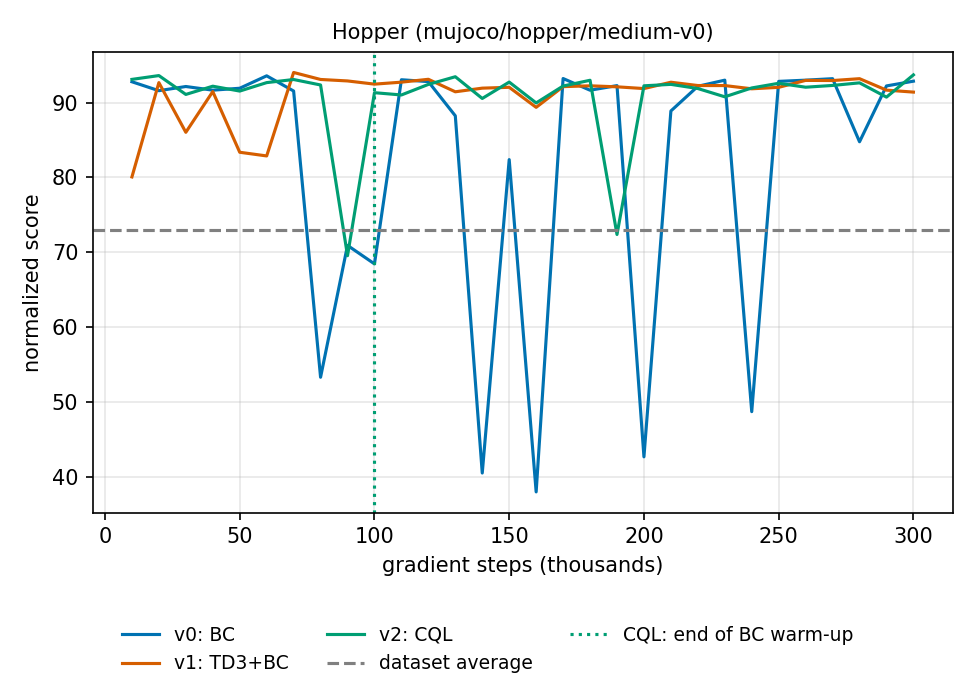
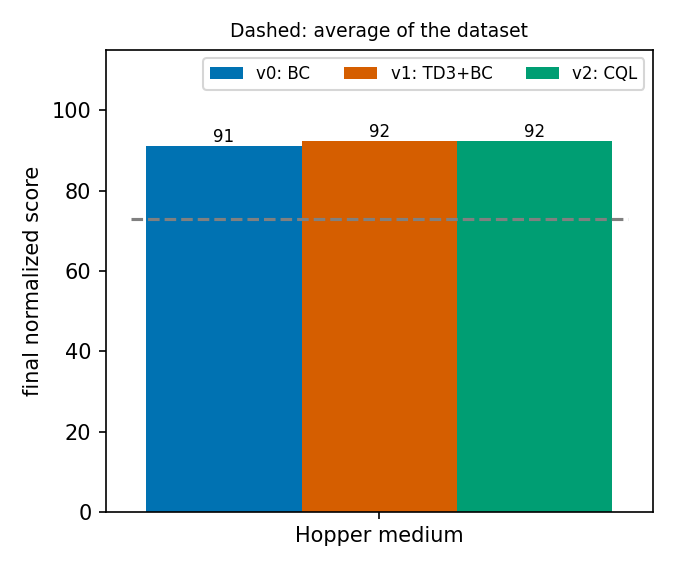

# Offline-RL

Offline reinforcement learning on fixed datasets, one idea at a time: behaviour cloning (version0), TD3+BC, which adds a critic and keeps the policy close to the data (version1), and conservative Q-learning (CQL), which instead makes the critic pessimistic about actions the data does not contain (version2). All three learn from the Minari *medium* dataset of Hopper and never interact with the environment except to evaluate the learned policy.

---

## Theory

Please note that the theory corresponding to the codes is hosted on this [page](https://parag1604.github.io/notes/Reinforcement-Learning/Offline-Reinforcement-Learning). The code follows its notation: a dataset $\mathcal{D}$ collected by a behaviour policy $\pi_\beta$, a learned policy $\pi_\theta$, critics $Q_\phi$ and discount $\gamma$. The online algorithms these build on (TD3, SAC) are in the [Actor-Critic](https://github.com/parag1604/Actor-Critic) repository.

## Python Environment Setup

Python >= 3.10, then:

```bash
pip install -r requirements.txt
```

A GPU is recommended (the results below used one); everything also runs on a CPU, only more slowly. `gymnasium[mujoco]` provides the Hopper-v5 environment used for evaluation, and `minari` loads the dataset.

## Data

The dataset comes from [Minari](https://minari.farama.org/) (Farama Foundation), the maintained successor of D4RL:

| Task | Minari dataset ID | Transitions | Episodes | Mean episode return |
|---|---|---|---|---|
| Hopper-v5 | `mujoco/hopper/medium-v0` | 999,404 | 1,327 | 2818 |

It was collected by a single SAC policy trained part of the way (Stable-Baselines3); see the dataset page on the Minari website. Download it (about 130 MB) with

```bash
minari download mujoco/hopper/medium-v0
```

It goes to `~/.minari/datasets` unless the environment variable `MINARI_DATASETS_PATH` points elsewhere.

**Normalized score.** As in D4RL, results are reported as

$$
\text{score} = 100 \cdot \frac{R - R_{\mathrm{random}}}{R_{\mathrm{expert}} - R_{\mathrm{random}}},
$$

so 0 is a uniformly random policy and 100 an expert. The Minari MuJoCo datasets ship no reference returns, so we measured them (see `common.py`): $R_{\mathrm{random}} = 17.0$ is the mean return of 100 episodes of the uniform random policy, and $R_{\mathrm{expert}} = 3857.8$ is the mean episode return of the matching expert dataset `mujoco/hopper/expert-v0`. The medium dataset itself scores 72.9. These references differ from D4RL's (different environment versions and expert policies), so the numbers here **cannot be compared with D4RL tables**.

## Running

`common.py` holds the shared pieces: the dataset as a GPU replay buffer (with state normalization by the dataset mean and standard deviation), the networks, evaluation and the normalized score. Every script has `--help`, `--steps` (gradient steps), `--eval-every` and `--log runs/x.json`. Every 10k gradient steps the deterministic policy (the mean action) is evaluated for 10 episodes in the real environment.

`bash run_experiments.sh <python>` runs all three versions (three runs in parallel on one GPU), and `python plot_results.py` draws the figures in `static/` and prints the numbers quoted below.

### version0: behaviour cloning

```bash
python version0.py
```

Supervised learning of the dataset's actions, $\min_\theta \mathbb{E}_{(s,a)\sim\mathcal{D}} \lVert \pi_\theta(s) - a \rVert^2$. It ignores the rewards and can at best recover the behaviour policy, but on data from a single reasonably good policy that is already a strong baseline.

### version1: TD3+BC

```bash
python version1.py
python version1.py --alpha 0      # the actor reduces to BC
```

TD3 (twin critics, target policy smoothing, delayed actor updates) with one extra term in the actor objective (Fujimoto & Gu, 2021):

$$
\max_\theta \; \mathbb{E}_{(s,a)\sim\mathcal{D}} \Big[ \lambda \, Q_{\phi_1}(s, \pi_\theta(s)) - \big(\pi_\theta(s) - a\big)^2 \Big], \qquad \lambda = \frac{\alpha}{\frac{1}{B}\sum_{(s,a)} \lvert Q_{\phi_1}(s,a) \rvert}, \quad \alpha = 2.5 .
$$

The BC term keeps the policy where the critic was trained; $\lambda$ makes the trade-off independent of the reward scale.

### version2: CQL

```bash
python version2.py
python version2.py --cql-alpha 0   # plain offline SAC
```

Soft actor-critic whose critics are trained with the CQL($\mathcal{H}$) regularizer (Kumar et al., 2020):

$$
\alpha_{\mathrm{cql}} \, \mathbb{E}_{s\sim\mathcal{D}} \Big[ \log \sum_a \exp Q_\phi(s,a) - \mathbb{E}_{a\sim\mathcal{D}(\cdot\mid s)} Q_\phi(s,a) \Big] + \tfrac12 \mathbb{E}_{\mathcal{D}} \big[ (Q_\phi(s,a) - y)^2 \big], \qquad \alpha_{\mathrm{cql}} = 5 .
$$

The log-sum-exp over actions is estimated by importance sampling with 10 actions from each of three proposals (uniform, $\pi_\theta(\cdot\mid s)$ and $\pi_\theta(\cdot\mid s')$). It pushes $Q$ down wherever the policy (or anything else) would look for high values, and up on the actions in the data. The actor is a tanh-squashed Gaussian; for the first 100k steps (`--bc-steps`) it only imitates the data (MSE of its mean action, like version0) while the critic already trains with CQL, and then it switches to the SAC objective $\max_\theta \mathbb{E}[\min_i Q_{\phi_i}(s, a) - \tau \log \pi_\theta(a\mid s)]$ with a learned temperature $\tau$.

## Results

**Budget.** 300k gradient steps per run (batch 256, Adam), one seed, on one NVIDIA GB10 GPU: about 20 minutes for BC, 30 for TD3+BC and 100 for CQL. The papers train for 1M steps, so these scores are not their final numbers. "Final" below is the mean normalized score of the last 5 evaluations (the last 50k steps, 50 episodes).





| Dataset (average score of the data) | v0: BC | v1: TD3+BC | v2: CQL |
|---|---|---|---|
| Hopper medium (72.9) | 91.2 | 92.4 | 92.3 |

What the runs show:

- **BC beats the data.** The data was recorded from a *stochastic* SAC policy; BC learns the mean action, which is apparently better than the noisy actions that were actually taken (91 vs 73). On medium data, collected by a single fair policy, plain imitation is hard to beat.
- **The critic adds stability.** All three end at about 92, but TD3+BC and CQL are steadier than BC, whose evaluations occasionally drop to about 40 when the hopper falls.
